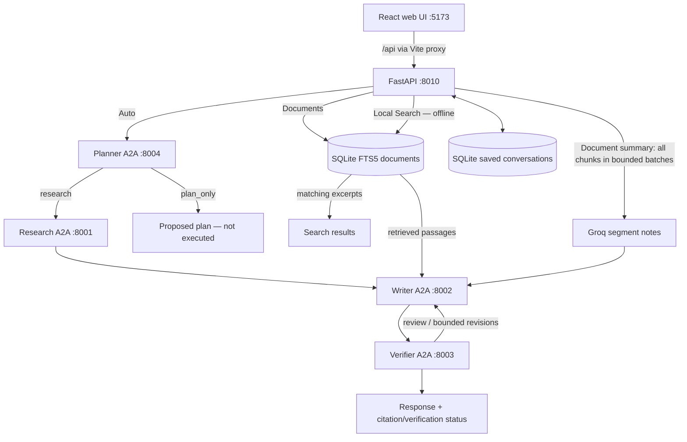

<div align="center">

# A2A Multi-Agent

### A local-first AI assistant powered by cooperating agents

**Plan. Research. Write. Verify. Explore your own documents.**

[](https://github.com/Roshan-R-S/A2A-Multi-Agent/releases/tag/v0.4.0)


[**Features**](#features) · [**Architecture**](#architecture) · [**Quick start**](#quick-start-windows-powershell) · [**Using the app**](#using-the-app) · [**Security**](#security-and-privacy) · [**Release**](#release-and-project-status)

</div>

---

**A2A Multi-Agent** is a single-user, local-first assistant built with Python, FastAPI, React, and the [Agent2Agent (A2A) protocol](https://a2a-protocol.org/). Four independently running agents collaborate to route a request, collect evidence, generate an answer, and check its citations. A local SQLite knowledge base adds document search and retrieval-augmented answers; conversation history and contextual memory are opt-in.

> [!IMPORTANT]
> **v0.4.0 is a released local MVP, not a production-hosted or autonomous assistant.** The API is bound to `127.0.0.1` and does **not** implement authentication or user-level authorization. Do not expose the API or development server to the public internet.

## Features

| Area | What works in v0.4.0 |
|---|---|
| **Four A2A agents** | Planner, Research, Writer, and Verifier run as separate services and communicate using A2A/JSON-RPC. |
| **Intelligent routing** | Planner chooses between evidence-backed research and a **proposed** plan (`plan_only`); plans are not executed. |
| **Research and citations** | Tavily-assisted public web research, source/evidence collection, and `[src_N]` citations. |
| **Answer verification** | Citation checks and model-based semantic review; verification failures can trigger bounded Writer revisions. |
| **Local RAG** | Explicitly index UTF-8 TXT/Markdown files and retrieve matching passages with SQLite FTS5. |
| **Full-document summaries** | Process all indexed chunks of an eligible document in bounded segments, then compose and check a summary against condensed notes. |
| **Privacy controls** | Separate switches for cloud AI access, saving new messages, and using previously saved conversation context. |
| **Conversation management** | Locally persisted chat history, titles derived from first saved questions, rename, reopen, and delete. |
| **Context-aware follow-ups** | Optionally include up to six recent saved messages from **the current conversation** in AI requests. |
| **Web experience** | Nothing-inspired React/TypeScript UI, OLED-dark/paper-light themes, responsive layouts, and Chat, Knowledge, Agents, and History pages. |
| **Routing and errors** | Direct links, browser Back/Forward, a client-side 404 page with return-home behavior, and proper API error responses. |

### What this project is *not*

It does not autonomously execute plans, operate your computer, provide user accounts, run as a public multi-tenant service, support PDF/DOCX ingestion, or use vector/embedding-based semantic search. The Agent Control Station documents capabilities; it is **not** a real-time per-agent monitor. Automated verification does **not** guarantee factual correctness.

## Architecture



**Workflow behavior**

- **Auto:** The Planner uses Groq to choose `research` or `plan_only`. Research requests use Tavily followed by Research → Writer → Verifier. Planning-only responses describe possible steps; they do not perform them.
- **Documents:** Indexed passages from local SQLite are used as evidence for Writer → Verifier. Matching excerpts leave the device **only when cloud AI is explicitly allowed**.
- **Local Search:** SQLite keyword search returns excerpts directly. It does not call Groq, Tavily, or A2A agents.
- **Summarize document:** The complete ordered indexed text is split into bounded segments. Groq creates compact notes; Writer and Verifier work from those notes rather than checking the final draft directly against every original sentence. The UI discloses the resulting verification scope.

Each A2A service exposes its discovery card at `/.well-known/agent-card.json`; JSON-RPC requests use **`POST /`**. A browser `GET /` on an agent port may return `405 Method Not Allowed` by design. Use the **React web app** at port 5173 instead.

## Technology stack

| Layer | Technology |
|---|---|
| Runtime / tooling | Python (developed using 3.10), [`uv`](https://docs.astral.sh/uv/), `pyproject.toml` / `uv.lock` |
| Agent communication | A2A SDK, JSON-RPC over HTTP, Uvicorn, HTTPX |
| AI and research | Groq (`openai/gpt-oss-120b` configured by default), Tavily |
| API | FastAPI, Pydantic |
| Local retrieval / history | SQLite with FTS5, local conversation tables |
| Web UI | React 19, TypeScript, Vite 7, React Markdown, Lucide |
| UI style | Nothing-inspired monochrome design, dark/light/system theme support |
| Testing | pytest, pytest-asyncio, TypeScript compiler, Vite build |

> The GitHub milestone is tagged **`v0.4.0`**. The Python package version in `pyproject.toml` is still **`0.1.0`**; these version identifiers have not been synchronized.

## Quick start (Windows PowerShell)

### Requirements

- Python 3.10 (the version used to develop and test this project; declared range is `>=3.10,<3.15`)
- [`uv`](https://docs.astral.sh/uv/getting-started/installation/)
- Node.js and npm
- A **Groq API key** for cloud-powered generation/verification
- A **Tavily API key** for web-backed research (not needed for offline Local Search)

### 1. Clone and install

```powershell
# Clone to any folder you prefer
git clone https://github.com/Roshan-R-S/A2A-Multi-Agent.git
cd A2A-Multi-Agent

# Python dependencies and environment
uv venv --python 3.10
uv sync

# Frontend dependencies
npm.cmd --prefix .\web install
```

If you already cloned the repo at `D:\a2a-multi-agent`, run the commands there instead. The `uv venv` step is needed only for a fresh environment.

### 2. Configure environment variables

```powershell
Copy-Item .env.example .env
```

Edit `.env` with your own credentials. Example values:

```dotenv
GROQ_API_KEY=your_groq_key_here
GROQ_MODEL=openai/gpt-oss-120b
TAVILY_API_KEY=your_tavily_key_here

RESEARCH_AGENT_HOST=127.0.0.1
RESEARCH_AGENT_PORT=8001
WRITER_AGENT_HOST=127.0.0.1
WRITER_AGENT_PORT=8002
VERIFIER_AGENT_HOST=127.0.0.1
VERIFIER_AGENT_PORT=8003

# Optional: Planner has these defaults if omitted
PLANNER_AGENT_HOST=127.0.0.1
PLANNER_AGENT_PORT=8004
```

**Never commit `.env`, API keys, the local SQLite database, or uploaded files.** The sample `.env.example` contains placeholders only.

### 3. Start the services

Use **six separate PowerShell terminals** from the project root: four agents, one API server, and one frontend server.

| Terminal | Service | Command | Port |
|---|---|---|---|
| 1 | Research | `uv run python -m agents.research.app` | `8001` |
| 2 | Writer | `uv run python -m agents.writer.app` | `8002` |
| 3 | Verifier | `uv run python -m agents.verifier.app` | `8003` |
| 4 | Planner | `uv run python -m agents.planner.app` | `8004` |
| 5 | Web API | `uv run python -m web_api.main` | `8010` |
| 6 | React/Vite | `npm.cmd --prefix .\web run dev` | `5173` |

Open **<http://127.0.0.1:5173>** after the services start.

- API health: <http://127.0.0.1:8010/api/health>
- API docs: <http://127.0.0.1:8010/docs>
- Individual agent health: `http://127.0.0.1:8001/health` (substitute `8002`, `8003`, or `8004`)
- Agent discovery: `http://127.0.0.1:8001/.well-known/agent-card.json` (substitute the agent port)

**Health note:** `/api/health` only confirms FastAPI is reachable. It does not confirm the four agents or cloud providers are operational.

### 4. Optional command-line workflows

```powershell
# Research → Writer → Verifier
uv run python -m orchestrator.main

# Planner-enabled request
uv run python -m orchestrator.smart_main "Explain RAG versus fine-tuning"

# Offline file indexing and search
uv run python -m orchestrator.knowledge_main ingest .\README.md
uv run python -m orchestrator.knowledge_main documents
uv run python -m orchestrator.knowledge_main search "Planner Writer Verifier"
```

The CLI knowledge commands support `ask ... --allow-cloud`, `history`, `forget`, and document deletion; see [`orchestrator/knowledge_main.py`](orchestrator/knowledge_main.py).

## Using the app

### Pages and URLs

| UI page | URL | Purpose |
|---|---|---|
| Chat | `/` (`/chat` alias) | Ask questions and choose a workflow mode. |
| Knowledge | `/knowledge` | Upload, search, summarize, or delete indexed documents. |
| Agents | `/agents` | Explore the four declared agent roles and flow. |
| History | `/history` | Reopen, rename, or delete saved conversations. |

Direct URL navigation, reload, and Back/Forward are supported. Invalid frontend routes show a **client-rendered 404 screen** and return home automatically after five seconds (or immediately using its button). Vite's single-page-app fallback may still return HTTP 200 for an invalid browser-facing UI URL; **unknown API endpoints return actual HTTP 404**.

### Chat modes and consent

| Mode | What it does | Cloud permission required? |
|---|---|---|
| **Auto** | Planner decides research or a proposed, non-executed plan. | **Yes** |
| **Documents** | Local retrieval → Writer → Verifier using indexed excerpts. | **Yes** |
| **Local Search** | Direct SQLite FTS5 keyword search; no remote services. | **No** |

The composer exposes three independent controls:

- **ALLOW EXTERNAL AI** — required for Auto/Documents. Remote services may receive your question, and Documents mode may send matching text excerpts.
- **SAVE HISTORY** — stores successful user/assistant exchanges in the local SQLite database. Disabled by default; it does not turn on contextual memory.
- **USE SAVED CONTEXT** — opt-in and off by default. With cloud permission, up to **six recent saved messages** from the same conversation are included in the AI request (with size limits). Available for Auto/Documents only, not Local Search. It does **not** automatically remember unsaved turns.

Existing saved conversations can be reopened, renamed (1–80 characters), and deleted. New conversation titles are derived locally from the first saved question — no extra LLM call is made to generate a title. Internal conversation IDs are used by the API but are not displayed as sidebar titles.

### Local knowledge and full-document summaries

- Supported documents: `.txt`, `.md`, `.markdown` (UTF-8 text, up to **2 MiB** per file).
- Files must be explicitly uploaded or ingested; no background file-system scanning.
- Search is **lexical/keyword-based FTS5**, not embedding or semantic vector search.
- **SUMMARIZE** reads the selected document's indexed chunks in order, for documents within **48,000 indexed characters / 80 chunks**. It requires its own explicit cloud consent and sends document content to Groq during segment-note creation.
- The final answer is reviewed against **condensed segment notes**, not every original document sentence. If agent verification fails, the UI shows **unverified attributed notes** rather than claiming a verified summary. Summaries can still omit details or contain mistakes.
- Groq rate limits or service availability may prevent a summary from completing; retrying the same oversized request does not necessarily help.

Saved data lives under `.a2a_data/` by default and is **not encrypted at rest**. If you revise an indexed source such as this README, re-ingest it to update the local index:

```powershell
uv run python -m orchestrator.knowledge_main ingest .\README.md
```

## API reference (local use only)

The API is served by FastAPI at `http://127.0.0.1:8010`. Interactive docs: [`/docs`](http://127.0.0.1:8010/docs).

| Method | Endpoint | Action |
|---|---|---|
| `GET` | `/api/health` | API liveness check |
| `GET` | `/api/documents` | List indexed documents |
| `POST` | `/api/documents` | Index uploaded TXT/Markdown content |
| `DELETE` | `/api/documents/{document_id}` | Remove a document |
| `POST` | `/api/documents/{document_id}/summary` | Summarize indexed document (cloud opt-in) |
| `GET` | `/api/search?q=...` | Offline FTS5 search |
| `GET` | `/api/conversations` | List saved conversations and titles |
| `GET` | `/api/conversations/{conversation_id}` | Read saved messages; missing ID returns 404 |
| `PATCH` | `/api/conversations/{conversation_id}` | Rename a conversation |
| `DELETE` | `/api/conversations/{conversation_id}` | Delete a conversation |
| `POST` | `/api/chat` | Route a chat request |

Example local-only chat request (with no cloud access):

```powershell
$body = @{
    message = 'Find notes about verification'
    conversation_id = 'readme_demo'
    mode = 'search'
    allow_cloud = $false
    save_history = $false
    use_context = $false
} | ConvertTo-Json

Invoke-RestMethod -Uri 'http://127.0.0.1:8010/api/chat' -Method Post -ContentType 'application/json' -Body $body
```

The API validates inputs and returns meaningful 403/404/422 errors. Responses carry `Cache-Control: no-store`, `X-Content-Type-Options: nosniff`, and `Referrer-Policy: no-referrer`. Browser-origin checks reduce certain cross-site requests; they **do not authenticate callers**.

## Validation

Run from the repository root:

```powershell
uv run pytest -q
npm.cmd --prefix .\web run build
git diff --check
git status --short
```

**Last reported local validation (October 10, 2026):**

- **304 Python tests passed**, 1 skipped; one non-blocking Starlette/httpx deprecation warning.
- TypeScript compilation (`tsc --noEmit`) and the Vite production build passed.
- `GET /api/unknown` returned HTTP 404 with `no-store`, `nosniff`, and `no-referrer` headers.
- Git `main` was clean and up to date.

These are results from the local release checks, **not** a claim of a continuously running CI suite. Before shipping future changes, rerun the checks and verify key browser flows (page refresh, invalid routes, Back/Forward, Local Search without cloud access, saved history, document summarization, and agent connectivity).

## Project structure

```text
A2A-Multi-Agent/
├── agents/
│   ├── planner/              # Intent routing / proposed plans :8004
│   ├── research/             # Public research and evidence :8001
│   ├── writer/               # Drafting and revision :8002
│   └── verifier/             # Citation/semantic review :8003
├── core/                     # Configuration, Groq client, logging
├── orchestrator/
│   ├── routed_workflow.py    # Planner-based routing
│   ├── workflow.py           # Research → Writer → Verifier
│   ├── revision_loop.py      # Bounded revision flow
│   ├── local_rag.py          # SQLite results → Writer → Verifier
│   ├── document_summary.py   # Bounded full-document summarization
│   └── conversation_context.py  # Optional saved-message context
├── knowledge/                # Chunking, SQLite FTS5, document indexing
├── memory/                   # Saved conversations and persistent titles
├── web_api/                  # FastAPI endpoints, validations, error responses
├── web/
│   └── src/                 # React pages, routing, components, design tokens
├── tests/                    # API, routing, agent and workflow tests
├── .env.example              # Environment variable template
├── pyproject.toml
├── uv.lock
└── README.md
```

Generated `.a2a_data/`, virtual environments, uploaded data, and frontend build outputs are local artifacts, not release source files.

## Security and privacy

> [!WARNING]
> **Local-only single-user MVP.** No login, authentication, per-user authorization, encrypted local database, HTTPS termination, or public deployment protections are provided. Keep FastAPI and Vite bound to loopback; do not forward these ports or deploy the current API to a public host.

- Origin/Fetch Metadata checks, a trusted-host restriction, and response headers add defense-in-depth **for the intended local browser workflow**. Origin headers are not identity proofs and can be spoofed by non-browser clients.
- Knowing or guessing a conversation ID is **not** an authorization boundary. Other processes on the same host that can reach the local API may be able to access the stored data.
- Cloud consent applies per request. Web research and document processing may send data to Groq/Tavily as described by the selected mode and controls.
- Indexed files, saved messages, and uploaded content are not encrypted at rest. Be careful with confidential material.
- External webpage and document text is untrusted. Prompt-injection and SSRF mitigations are not comprehensive.
- Model-generated summaries, plans, and citation checks must be reviewed before making consequential decisions.

For a future public or multi-user release, add real authentication, per-resource authorization, HTTPS, request/CSRF protections, deployment controls, secrets management, auditing, and security testing before changing the bind addresses.

## Limitations and future work

This release intentionally leaves the following for later versions:

- Vector embeddings, semantic retrieval, and PDF/DOCX ingestion.
- Real-time token streaming and a live per-agent status/trace dashboard.
- Autonomous tool execution, browser/computer control, and user-approved actions.
- Multi-user accounts, remote hosting, and production security hardening.
- Broader evaluation, stronger adversarial testing, and simplified packaging/installers.

The project is useful as an **A2A architecture, local RAG, and AI workflow demonstration**, with clearly bounded capabilities.

## Release and project status

- **Current GitHub milestone:** [v0.4.0 — Local MVP](https://github.com/Roshan-R-S/A2A-Multi-Agent/releases/tag/v0.4.0)
- **Source code:** [Roshan-R-S/A2A-Multi-Agent](https://github.com/Roshan-R-S/A2A-Multi-Agent)
- **Release snapshot:** The `v0.4.0` tag records the released code. README edits merged **after** tagging appear on `main` but do not retroactively change the tagged snapshot.

Additional implementation notes: [`PHASE2_RAG_MEMORY.md`](PHASE2_RAG_MEMORY.md), [`PHASE2_WEB_UI.md`](PHASE2_WEB_UI.md), [`PHASE4_CONTEXT_MEMORY.md`](PHASE4_CONTEXT_MEMORY.md), [`PHASE4_FRONTEND_POLISH.md`](PHASE4_FRONTEND_POLISH.md), and [`ROUTE_AND_API_HARDENING.md`](ROUTE_AND_API_HARDENING.md).

## License

A project-level license has **not** been declared in this repository. Do not assume the project is licensed for unrestricted reuse. Third-party dependencies are subject to their respective licenses.

---

<div align="center">

**A2A Multi-Agent** · Four specialized agents · Local-first knowledge · Explicit AI consent

[Back to top ↑](#a2a-multi-agent)

</div>
